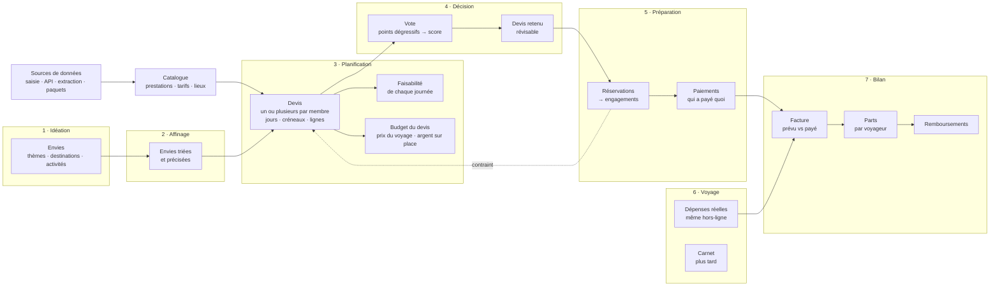
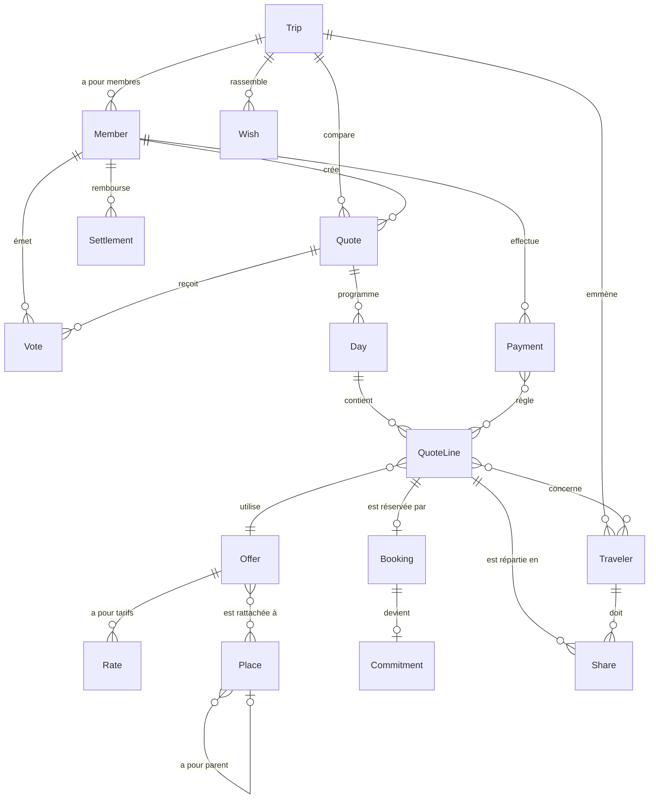

# Schéma fonctionnel

> Première version, issue de la [vision](../vision.md) et du [glossaire](../glossaire.md). Le modèle
> de domaine est une esquisse : il sera ajusté par la calibration avec des voyages réels.

## Le cycle de vie d'un voyage

À chaque étape, les **vues** (timeline, planning, carte, programme, graphiques) affichent les mêmes
données sous des angles différents.

## Qui fait quoi

| Acteur | Ce qu'il fait |
| --- | --- |
| Membre | Note des envies, crée et compare des devis, vote, retient un devis, enregistre réservations, paiements et dépenses |
| Voyageur | Part en voyage ; reçoit une part des coûts. N'a pas forcément accès à Voyager (un enfant) |
| Propriétaire de l'instance | Installe le serveur du groupe, configure les clés d'API payantes, installe les plugins |
| Plugins | Fournissent types de prestation, bases de calcul, règles de répartition, connecteurs, vues, exports |

## Le modèle de domaine (esquisse)

Noms de code anglais, définis dans le [glossaire](../glossaire.md).

Points à valider pendant la calibration :

- les dépenses réelles pendant le voyage sont-elles des lignes de devis, ou un objet à part ?
- où se rattachent les coûts indirects (repas) : à un jour, à un voyageur, aux deux ?
- une ligne de devis peut-elle porter sur plusieurs jours (une location de voiture sur une semaine) ?
