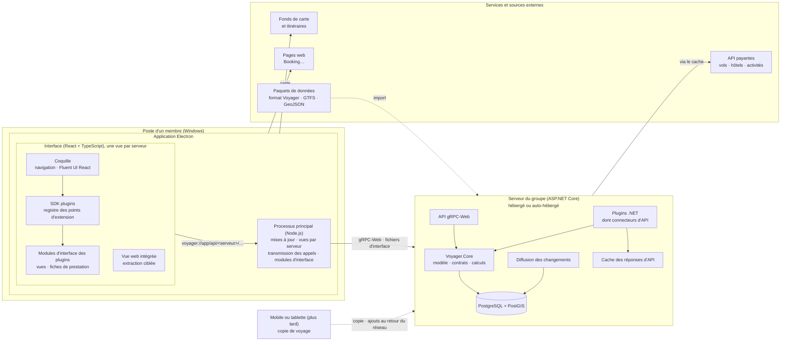
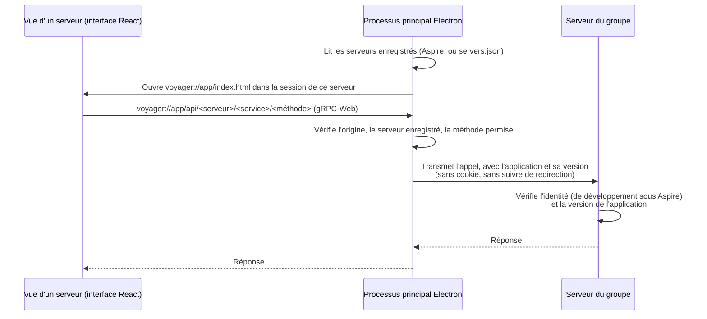
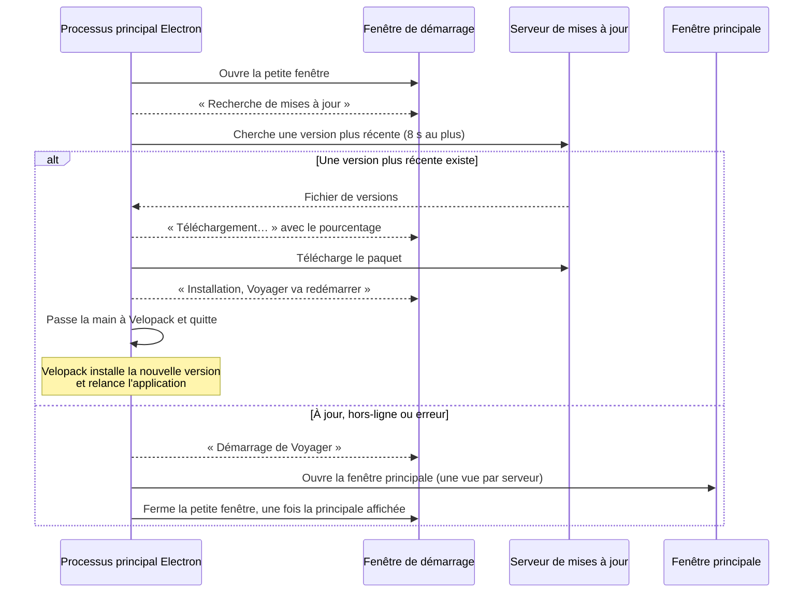
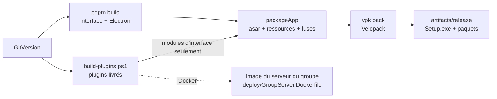
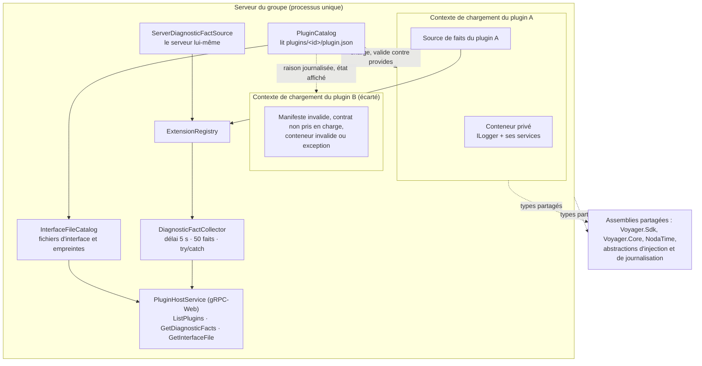
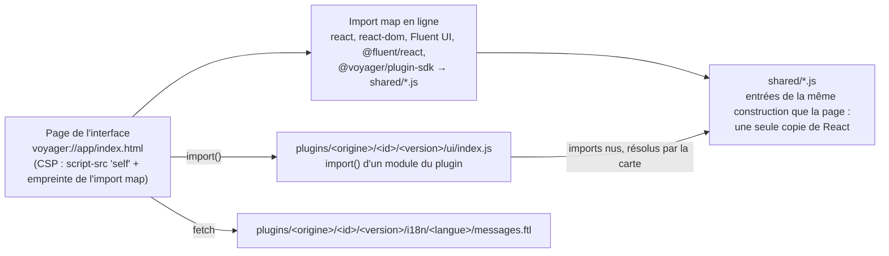
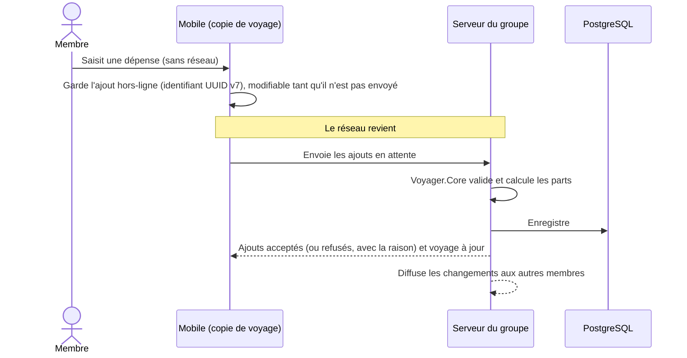

# Schéma technique

> Issu des ADR [0002](../adr/0002-architecture-modulaire-par-contrats-et-plugins.md),
> [0003](../adr/0003-choix-de-la-stack.md), [0018](../adr/0018-client-serveur-et-copie-de-voyage.md),
> [0019](../adr/0019-authentification-et-invitations.md) et [0020](../adr/0020-plugins-sur-le-serveur.md), et
> de la [bascule vers le client-serveur](../specs/plateforme-bascule-client-serveur.md).

## Vue d'ensemble

## Les composants

| Composant | Rôle | Technologie |
| --- | --- | --- |
| Processus principal Electron | Fenêtre, mises à jour, une vue par serveur enregistré, transmission des appels de la page au serveur, téléchargement et vérification des modules d'interface des plugins | Electron, Node.js |
| Interface | Afficher et saisir ; **aucun calcul métier** | React, TypeScript, Fluent UI React |
| SDK plugins | Registre où les modules d'interface des plugins déclarent ce qu'ils fournissent | TypeScript (`@voyager/plugin-sdk`) |
| Vue web intégrée | Afficher une page (fiche d'hôtel…) et en extraire les informations utiles | Electron `WebContentsView` |
| Serveur du groupe | Seul hôte .NET et seule vérité : données des groupes, cœur, calculs, plugins, connecteurs d'API payantes (ADR-0018) | ASP.NET Core (.NET 10), gRPC-Web |
| Voyager.Core | Modèle commun, contrats, calculs (coûts, répartition, faisabilité) ; exécuté par le serveur | Bibliothèque .NET |
| Base du serveur | Données de référence et voyages des groupes | PostgreSQL + PostGIS (EF Core, Npgsql) |
| Copie de voyage (plus tard) | Un voyage emporté sur le mobile, consulté sans réseau, où l'on ne fait qu'ajouter (ADR-0018) | À définir |
| Cache d'API | Limiter les appels aux API payantes | À définir |

## Les flux

1. **Interface → serveur du groupe** : la page appelle `voyager://app/api/<serveur>/…` ; le processus
   principal transmet l'appel au serveur en gRPC-Web. La page n'appelle jamais le serveur elle-même et ne
   tient aucun jeton.
2. **Diffusion des changements** : le serveur poussera aux membres connectés les changements des autres (à
   venir).
3. **Copie de voyage** (plus tard) : le mobile télécharge la copie d'un voyage avant de partir, et envoie ses
   ajouts hors-ligne au retour du réseau (ADR-0018).
4. **API payantes** : appelées **par le serveur du groupe**, qui détient les clés configurées par le
   propriétaire de l'instance et met les réponses en cache. Les clés ne sont jamais copiées sur les
   postes.
5. **Extraction ciblée** : faite **sur le poste**, dans la vue web intégrée, pendant que le membre
   consulte la page.
6. **Paquets de données** : importés par le serveur du groupe, pour le groupe.
7. **Fonds de carte** : chargés directement par l'interface (fournisseur à choisir, Q5).

## La connexion au serveur du groupe

Mise en place par la [bascule vers le client-serveur](../specs/plateforme-bascule-client-serveur.md) (lot 2).

- **Les serveurs enregistrés** : en développement, celui qu'Aspire a lancé ; dans l'application installée,
  ceux de `%LOCALAPPDATA%\Voyager\servers.json` (aucun par défaut : la fenêtre dit « aucun serveur
  configuré »). La page ne désigne qu'un serveur enregistré, jamais une adresse.
- **Une vue par serveur** (`serverViews.ts`), chacune dans sa propre session Electron, en mémoire : le
  protocole de cette session ne transmet qu'à son serveur, donc les modules d'interface d'un serveur ne peuvent
  appeler que lui. Avec plusieurs serveurs, un sélecteur passe de l'un à l'autre.
- **Les méthodes permises** (`serverApi.ts`) : seulement celles de la page « À propos » pour l'instant ; tout
  autre appel est refusé et journalisé.
- **L'état de la connexion** (`ServerConnection`) : connecté, en cours de connexion, injoignable (avec la
  raison et « Réessayer ») ou application trop ancienne. Quand le serveur revient, la vue se reconnecte seule.

La fenêtre est verrouillée : `contextIsolation`, `sandbox`, pas de `nodeIntegration`, aucune nouvelle
fenêtre, aucune navigation hors de l'interface, aucune permission (caméra, position…). Dans
l'application installée, une Content Security Policy ne laisse en plus la page parler qu'à sa propre origine
(`voyager://app`).

**En développement**, Aspire (`Voyager.AppHost`) lance PostgreSQL + PostGIS, construit les plugins, lance le
serveur du groupe avec l'identité de développement, l'interface avec Vite, puis Electron, à qui il passe leurs
adresses et le dossier des plugins construits (`VOYAGER_UI_URL`, `VOYAGER_SERVER_URL`,
`VOYAGER_PLUGINS_DIRECTORY`). L'application installée ignore ces variables.

## Le démarrage de l'application installée

Mis en place par [ADR-0014](../adr/0014-ecran-de-demarrage-et-mise-a-jour-au-demarrage.md), révisé par la
bascule : l'écran de démarrage n'attend plus que la mise à jour. La fenêtre de démarrage est la même
interface, page `?screen=startup` : elle est traduite comme le reste.

La connexion à chaque serveur se montre ensuite dans la fenêtre principale. La source des mises à jour est
celle écrite dans le paquet à sa fabrication (`tools/release.ps1 -UpdateSource`), sinon les *releases*
GitHub ; elle doit être en `https` (ou en `http` vers la machine) car une mise à jour est du code que
l'application exécute et qu'aucune signature ne garantit encore. En développement, la fenêtre de démarrage
n'apparaît pas, sauf avec la variable `VOYAGER_SHOW_STARTUP_SCREEN` (ignorée par l'application installée) ;
elle n'appelle aucun serveur.

## Le paquet installable et les journaux

Mis en place par `tools/release.ps1` ([ADR-0009](../adr/0009-installation-et-mises-a-jour-velopack.md)).

L'application installée contient, dans son dossier de ressources, l'interface construite (`resources/ui`) et
les **modules d'interface** des plugins livrés (`resources/plugins` : `plugin.json`, `ui/`, `i18n/`, sans la
partie .NET, que seul le serveur exécute) ; le code d'Electron est dans l'archive `app.asar`, hors les modules
natifs (Velopack) qui restent à côté. Les *fuses* d'Electron sont posées sur l'exécutable et relues avant
d'emballer ; le canal (`stable`, `beta`, `alpha`) vient du suffixe de la version. Avec `-Docker`, le script
construit aussi l'image du serveur du groupe, avec les plugins livrés complets dans `/app/plugins`.

Au démarrage, l'application installée cherche une version plus récente, la télécharge et la fait
installer (voir plus haut). Hors-ligne, ou sans release publiée, elle continue et s'ouvre (une ligne dans
le journal). Une application lancée depuis un simple dossier (non installée) ne cherche rien.

**Données du poste**, dans `%LOCALAPPDATA%\Voyager`, que la désinstallation laisse : la liste des serveurs
(`servers.json`), les modules d'interface téléchargés (`servers\<serveur>\plugins`) et les journaux.

**Journaux** : un fichier pour l'application (`desktop.log`), dans `%LOCALAPPDATA%\Voyager\logs`. Les chemins
y sont masqués (`~` pour le dossier personnel) et la règle « aucune donnée personnelle » s'applique. Rien
n'est envoyé hors de la machine. Le serveur du groupe a ses propres journaux (Seq en développement, et un
fichier par jour, `Voyager.GroupServer-AAAAMMJJ.log`, quand le réglage `Voyager:LogDirectory` donne un dossier).

## Les plugins dans le serveur du groupe

Décidés par l'[ADR-0015](../adr/0015-mecanisme-de-plugins.md), éprouvés par la
[preuve des plugins](../specs/plateforme-preuve-des-plugins.md), placés sur le serveur par
l'[ADR-0020](../adr/0020-plugins-sur-le-serveur.md).

- Au démarrage, `PluginCatalog` lit les **plugins livrés** : `/app/plugins` dans l'image, `artifacts/plugins/`
  en développement (réglage `Voyager:ShippedPluginsDirectory`, refusé hors de l'environnement `Development`).
  Le dossier n'est jamais choisi par un utilisateur. Le serveur n'a pas encore de plugins installés : aucun
  n'est désactivé ni suspendu, et l'examen d'un paquet n'est pas servi. Tout cela viendra avec la gestion des
  plugins sur le serveur (ADR-0020), qui a sa spec à réécrire.
- Pour chaque sous-dossier : un manifeste valide, un identifiant égal au nom du dossier, utilisé une seule
  fois, des contrats pris en charge (chaque contrat fourni ou requis du manifeste, avec sa version, comparé à
  `ContractVersions` du SDK, ADR-0017 : une version obsolète ou inconnue écarte le plugin), puis le
  chargement de la partie .NET dans **son** contexte avec **son** conteneur d'injection. Tout échec écarte ce
  plugin seul, avec une raison ; le serveur démarre toujours.
- Un plugin **enregistre** (`builder.AddDiagnosticFactSource<T>()`), il ne remplace rien ; l'hôte vérifie
  l'inscription contre `provides` et la range dans le registre.
- À la demande de l'interface, le collecteur interroge toutes les sources en parallèle, chacune sous un
  délai et un `try/catch` : une source qui échoue, tarde ou renvoie des faits refusés est signalée, les
  autres s'affichent.
- `Voyager.PluginHost/Packages` garde l'**examen** et l'**extraction** d'un paquet `.voyagerplugin` (noms,
  contenu autorisé, manifeste, assemblies .NET, contrats, empreinte SHA-256), pour la future installation sur
  le serveur ; rien ne les appelle encore.

## Les plugins dans l'interface

Côté interface, la page charge ensuite la partie interface de chaque plugin chargé :

- Le processus principal sert `plugins/<origine>/<id>/<version>/ui/*.js` et
  `plugins/<origine>/<id>/<version>/i18n/<langue>/messages.ftl` (l'origine est `shipped` ou `installed` ; jamais le
  manifeste ni les assemblies), dans la version que le serveur a chargée (ADR-0020, décision 8) :
  - le serveur publie, pour chaque plugin **en service**, la liste de ses fichiers d'interface avec leur empreinte
    SHA-256 (`interface_files` de `ListPlugins`) et envoie un fichier à la demande (`GetInterfaceFile`, que la
    page ne peut pas appeler) ;
  - le processus principal sert la copie livrée avec l'application si sa version et ses empreintes sont les
    mêmes, sinon il télécharge chaque fichier, vérifie sa taille et son empreinte, et le range dans
    `%LOCALAPPDATA%\Voyager\servers\<serveur>\plugins\<id>\<version>` ; les versions qui ne servent plus sont
    nettoyées ;
  - un plugin écarté ou désactivé n'est pas servi, et un fichier doit rester dans le dossier de son plugin une
    fois les liens suivis.

  Il calcule aussi l'empreinte de l'import map de `index.html` pour la CSP. En développement aussi, la page lit
  les fichiers des plugins par `voyager://app` : le protocole les sert alors à l'origine de Vite, sous CORS.
- Le module d'un plugin exporte `register(registry)` ; l'interface refuse ce que le manifeste n'annonce pas.
  Un module qui ne charge pas, ou un panneau qui plante, met ce plugin « en erreur » sans toucher au reste.
- Les messages d'un plugin commencent par son identifiant ; ils rejoignent ceux de la page sans jamais en
  remplacer un.

## Un ajout hors-ligne, pas à pas (plus tard)

Décidé par l'[ADR-0018](../adr/0018-client-serveur-et-copie-de-voyage.md) ; rien n'est encore construit. Le
stockage de la copie sur le mobile reste à choisir.

## Ce qui reste à décider

- Plugins de tiers : signature des modules, isolation ; la gestion sur le serveur est décidée par
  l'[ADR-0020](../adr/0020-plugins-sur-le-serveur.md) et reste à construire.
- Copie de voyage : stockage sur le mobile, détails de l'envoi des ajouts (ADR-0018, à préciser avec le mobile).
- Hébergement du serveur du groupe (Q4), fournisseur de cartes (Q5), format d'échange (Q16).
