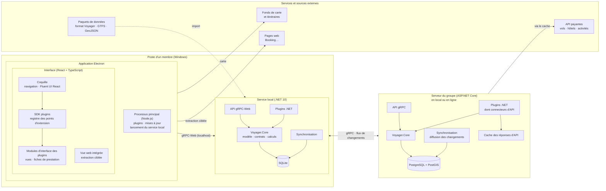
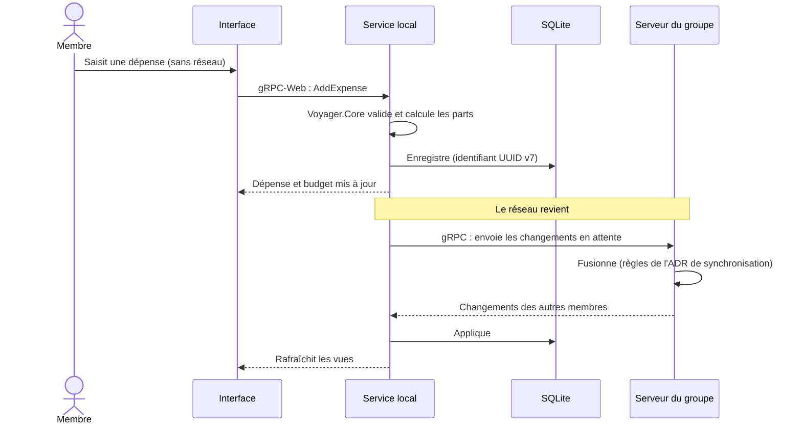

# Schéma technique

> Première version, issue des ADR [0002](../adr/0002-architecture-modulaire-par-contrats-et-plugins.md),
> [0003](../adr/0003-choix-de-la-stack.md) et [0004](../adr/0004-stockage-des-donnees.md).

## Vue d'ensemble

## Les composants

| Composant | Rôle | Technologie |
| --- | --- | --- |
| Processus principal Electron | Fenêtre, mises à jour, installation des plugins, lancement et surveillance du service local | Electron, Node.js |
| Interface | Afficher et saisir ; **aucun calcul métier** | React, TypeScript, Fluent UI React |
| SDK plugins | Registre où les modules d'interface des plugins déclarent ce qu'ils fournissent | TypeScript (`@voyager/plugin-sdk`) |
| Vue web intégrée | Afficher une page (fiche d'hôtel…) et en extraire les informations utiles | Electron `WebContentsView` |
| Service local | Logique métier, base hors-ligne, synchronisation, parties .NET des plugins | ASP.NET Core (.NET 10), gRPC-Web |
| Voyager.Core | Modèle commun, contrats, calculs (coûts, répartition, faisabilité) ; partagé client et serveur | Bibliothèque .NET |
| Serveur du groupe | Données partagées du groupe, synchronisation, connecteurs d'API payantes | ASP.NET Core (.NET 10), gRPC |
| Base locale | Copie de travail du membre, hors-ligne | SQLite (EF Core) |
| Base du serveur | Données de référence et voyages du groupe | PostgreSQL + PostGIS (EF Core, Npgsql) |
| Cache d'API | Limiter les appels aux API payantes | À définir |

## Les flux

1. **Interface → service local** : toujours en gRPC-Web sur la machine, même en ligne. L'interface ne
   parle jamais directement au serveur du groupe.
2. **Service local ↔ serveur du groupe** : synchronisation en gRPC quand le réseau est là ; le serveur
   pousse en flux les changements des autres membres.
3. **API payantes** : appelées **par le serveur du groupe**, qui détient les clés configurées par le
   propriétaire de l'instance et met les réponses en cache. Les clés ne sont jamais copiées sur les
   postes.
4. **Extraction ciblée** : faite **sur le poste**, dans la vue web intégrée, pendant que le membre
   consulte la page.
5. **Paquets de données** : importés par le service local, puis partagés avec le groupe par la
   synchronisation.
6. **Fonds de carte** : chargés directement par l'interface (fournisseur à choisir, Q5).

## Une saisie hors-ligne, pas à pas

## Ce qui reste à décider

- Mécanisme de plugins : format du paquet, signature, chargement, rechargement (ADR à venir).
- Synchronisation : résolution des conflits, suppressions, historique (ADR à venir).
- Hébergement du serveur du groupe (Q4), fournisseur de cartes (Q5), format d'échange (Q16).
