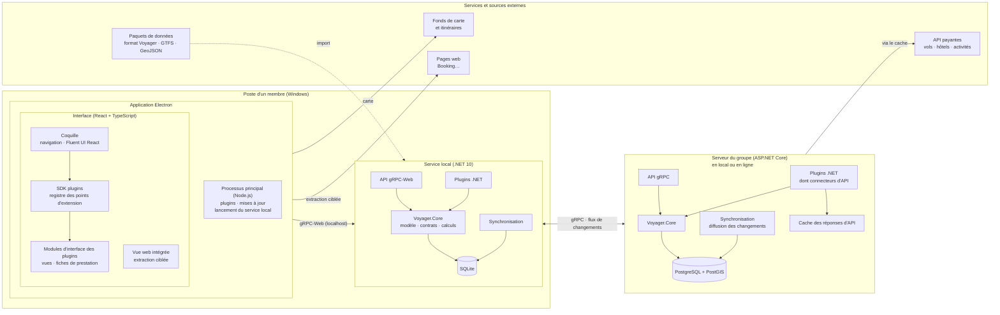
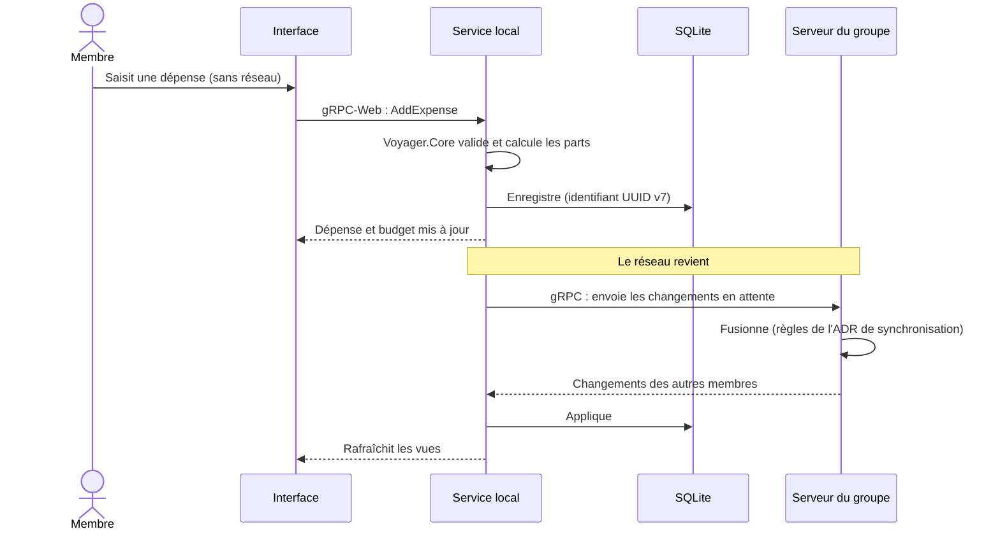

# Schéma technique

> Première version, issue des ADR [0002](../adr/0002-architecture-modulaire-par-contrats-et-plugins.md),
> [0003](../adr/0003-choix-de-la-stack.md) et [0004](../adr/0004-stockage-des-donnees.md).

## Vue d'ensemble



## Les composants

| Composant | Rôle | Technologie |
| --- | --- | --- |
| Processus principal Electron | Fenêtre, mises à jour, installation des plugins, lancement et surveillance du service local, remise de son jeton à l'interface | Electron, Node.js |
| Interface | Afficher et saisir ; **aucun calcul métier** | React, TypeScript, Fluent UI React |
| SDK plugins | Registre où les modules d'interface des plugins déclarent ce qu'ils fournissent | TypeScript (`@voyager/plugin-sdk`) |
| Vue web intégrée | Afficher une page (fiche d'hôtel…) et en extraire les informations utiles | Electron `WebContentsView` |
| Service local | Logique métier, base hors-ligne, synchronisation, parties .NET des plugins | ASP.NET Core (.NET 10), gRPC-Web |
| Voyager.Core | Modèle commun, contrats, calculs (coûts, répartition, faisabilité) ; partagé client et serveur | Bibliothèque .NET |
| Serveur du groupe | Données partagées du groupe, synchronisation, connecteurs d'API payantes | ASP.NET Core (.NET 10), gRPC |
| Base locale | Copie de travail du membre, hors-ligne | SQLite (EF Core) |
| Base du serveur | Données de référence et voyages du groupe | PostgreSQL + PostGIS (EF Core, Npgsql) |
| Cache d'API | Limiter les appels aux API payantes | À définir |

## Les flux

1. **Interface → service local** : toujours en gRPC-Web sur la machine, même en ligne. L'interface ne
   parle jamais directement au serveur du groupe.
2. **Service local ↔ serveur du groupe** : synchronisation en gRPC quand le réseau est là ; le serveur
   pousse en flux les changements des autres membres.
3. **API payantes** : appelées **par le serveur du groupe**, qui détient les clés configurées par le
   propriétaire de l'instance et met les réponses en cache. Les clés ne sont jamais copiées sur les
   postes.
4. **Extraction ciblée** : faite **sur le poste**, dans la vue web intégrée, pendant que le membre
   consulte la page.
5. **Paquets de données** : importés par le service local, puis partagés avec le groupe par la
   synchronisation.
6. **Fonds de carte** : chargés directement par l'interface (fournisseur à choisir, Q5).

## Le démarrage et la connexion au service local

Mis en place par l'étape 2 du squelette (écran « À propos »).

```mermaid
sequenceDiagram
    participant P as Processus principal Electron
    participant L as Service local
    participant W as Fenêtre (interface React)
    P->>W: Ouvre voyager://app/index.html (fichiers de l'interface + CSP)
    P->>L: Lance l'exécutable avec un jeton secret tiré au hasard
    L->>L: Met la base SQLite à jour (migrations)
    L->>L: Écoute sur 127.0.0.1, sur un port libre qu'il choisit
    L-->>P: Annonce son adresse (VOYAGER_LISTENING …)
    W->>P: preload : getLocalService()
    P->>P: Vérifie que l'appel vient bien de voyager://app
    P-->>W: Adresse et jeton du service local
    W->>L: gRPC-Web + en-tête x-voyager-token
    L->>L: Refuse sans le bon jeton ; CORS : seule l'origine voyager://app
    L-->>W: GetServiceInfo : version, moteur, mode, démarrage, état de la base
```

Le service local reste lié à l'application : Electron garde ouverte son entrée standard, et le
service s'arrête dès qu'elle se ferme. À la fermeture normale, Electron attend qu'il ait fini
(5 secondes au plus) ; si Electron plante, le service s'arrête de lui-même au lieu de rester orphelin.

Ce qui protège le service local, que tout programme de la machine pourrait appeler :

- il n'écoute que sur `127.0.0.1`, sur un port choisi à chaque lancement ;
- chaque appel doit porter le **jeton** tiré au démarrage, que le processus principal ne remet
  qu'à la page de l'interface ;
- CORS n'autorise que l'origine de l'interface (`voyager://app`).

Le jeton protège des pages web ouvertes dans un navigateur, des autres comptes de la machine et des
requêtes détournées vers `127.0.0.1` (*DNS rebinding*). Il ne protège pas d'un logiciel malveillant
qui tourne déjà sous le compte du membre : celui-ci peut lire l'environnement et la mémoire des
processus du compte.

La fenêtre est verrouillée : `contextIsolation`, `sandbox`, pas de `nodeIntegration`, aucune nouvelle
fenêtre, aucune navigation hors de l'interface, aucune permission (caméra, position…). Dans
l'application installée, une Content Security Policy ne laisse en plus la page parler qu'à
`127.0.0.1`.

**En développement**, Aspire (`Voyager.AppHost`) lance lui-même le service local, avec un jeton
généré et une base à part (`%LOCALAPPDATA%\Voyager\development\voyager.db`), l'interface avec Vite,
puis Electron, à qui il passe leurs adresses et le jeton (`VOYAGER_UI_URL`,
`VOYAGER_LOCAL_SERVICE_URL`, `VOYAGER_LOCAL_TOKEN`) : Electron ne lance alors pas son propre
service. L'application installée ignore ces variables, et ne transmet à son service local que les
variables système du poste (chemins, dossier temporaire…), en mode Production.

## Une saisie hors-ligne, pas à pas



## Ce qui reste à décider

- Mécanisme de plugins : format du paquet, signature, chargement, rechargement (ADR à venir).
- Synchronisation : résolution des conflits, suppressions, historique (ADR à venir).
- Hébergement du serveur du groupe (Q4), fournisseur de cartes (Q5), format d'échange (Q16).
